<div align="center">


# QuickDrop

### Send anything. Open anywhere.

Anonymous, temporary, cross-device sharing. No accounts. No ads. Nothing permanent.

[](https://www.quickd.xyz)


**[Try it live → quickd.xyz](https://www.quickd.xyz)**

> This repository is a public showcase (docs, diagrams, screenshots). The source code lives in a private repository.

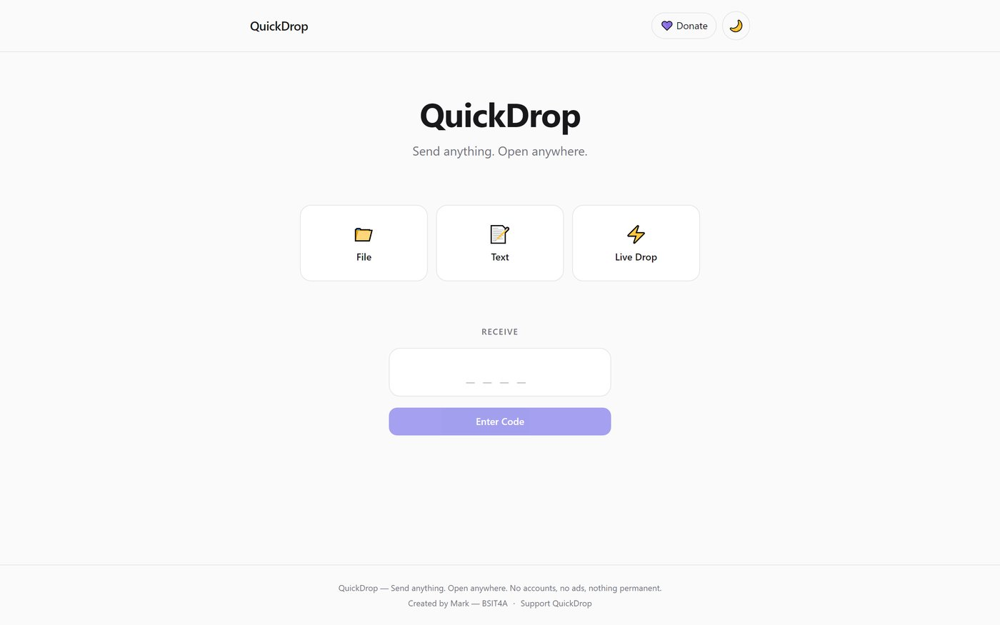

</div>

QuickDrop is an anonymous, temporary, cross-device sharing platform. Open
`quickd.xyz` on any two devices, share a file, some text, or a live session
between them, and it's gone when the timer runs out.

---

## Table of contents

- [Launch video](#launch-video)
- [Status](#status)
- [The problem](#the-problem)
- [How to use it](#how-to-use-it)
- [Core use case](#core-use-case)
- [Features](#features)
- [Screenshots](#screenshots)
- [Architecture](#architecture)
- [Tech stack](#tech-stack)
- [Security model](#security-model)
- [Privacy model](#privacy-model)
- [Storage architecture](#storage-architecture)
- [WebSocket / Live Drop architecture](#websocket--live-drop-architecture)
- [API overview](#api-overview)
- [Limitations](#limitations)
- [Future roadmap](#future-roadmap)

## Launch video

<div align="center">
  <video src="https://github.com/malasadongegg/Quickdrop-Public/raw/main/docs/video/quickdrop-launch.mp4" poster="docs/video/poster.jpg" controls muted width="760"></video>
  <br /><sub>Prefer a phone-sized cut? <a href="docs/video/quickdrop-launch-vertical.mp4">Watch the vertical version</a>. Player not loading? <a href="docs/video/quickdrop-launch.mp4">Open the video directly</a>.</sub>
</div>

---

## The problem

You have a PDF on your phone and need it on a school or public computer.
The "normal" options are all worse than they should be for a one-time
handoff: log into Messenger to send yourself a file, email it, or spin up
Google Drive and manage sharing permissions on a machine you don't trust and
don't want to leave signed in.

QuickDrop skips all of that. Upload, get a 4-character code, type the code
on the other device, download. The Drop deletes itself on a timer — nobody
has to remember to clean up after themselves on the school PC.

## Core use case

```text
PHONE                                   SCHOOL PC
  │                                          │
  ├─ Open quickd.xyz                         │
  ├─ Upload assignment.pdf                   │
  ├─ Expiration: 15 minutes                  │
  │                                          │
  └─ QuickDrop creates code: K7M2            │
                                              ├─ Open quickd.xyz
                                              ├─ Enter: K7M2
                                              ├─ assignment.pdf → [Download]
                                              └─ Walk away. No login, ever.

  ⏱ 15 minutes later: file + Drop are permanently deleted, server-side.
```

The same pattern extends to **Live Drop**: a temporary real-time room
between two or more devices for back-and-forth file/text exchange, ended
either by a timer or by the host explicitly burning it.

## Features

### 📁 File Drop
Upload one or many files (250 MB/file by default, configurable). Drag-and-drop
on desktop, native picker on mobile. Real upload progress (no fake bars).
Optional **burn after download** and **password protection**.

### 📝 Text Drop
Paste text, code, commands, or a link. Whitespace and formatting are
preserved. A submission that is *only* a URL is auto-detected and offered as
an external link (with its destination domain shown before opening) instead
of a payload to copy.

### ⚡ Live Drop — the flagship feature
A temporary real-time room. The host creates a session and gets a code;
guests request to join and the host must **approve** each one before they
can see or send anything. Text and files stream between all connected
participants instantly over WebSockets, presented as a lightweight
conversation view. The host can enable **group mode** to allow more than one
guest. Only the host can permanently end the session, which wipes all files
and messages and disconnects everyone.

### Shared to all Drop types
- **Server-authoritative expiration** — 5 / 10 / 15 / 30 minutes (deliberately short: storage is a small shared budget) /
  custom, always enforced by the backend, never the client clock.
- **Unified URLs** — `quickd.xyz/K7M2` always shows the Drop page first;
  nothing auto-downloads or auto-joins.
- **QR codes** for every Drop, pointing at that same unified URL.
- **Optional donations** - a popup explains donations are optional, that the servers are free-tier, and that QuickDrop runs with no ads or accounts, keeps only anonymous usage counts, and earns nothing. Set `VITE_DONATION_URL` to enable its Donate button.
- **Recent Drops**, stored per-browser via `localStorage`, with management
  tokens kept locally so you can come back and delete/manage a Drop you
  created — no account, no server-side session.

## Screenshots

<table>
  <tr>
    <td align="center">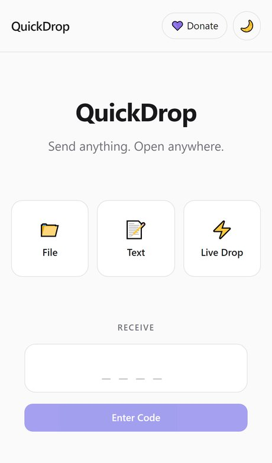<br /><sub>Home</sub></td>
    <td align="center">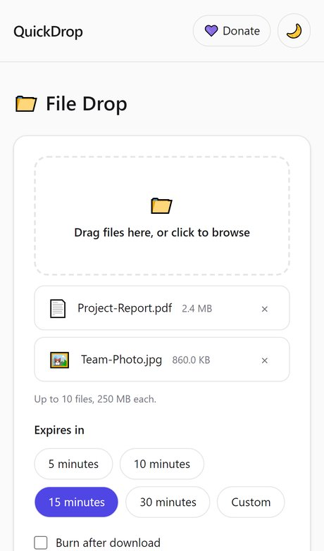<br /><sub>Send files</sub></td>
    <td align="center">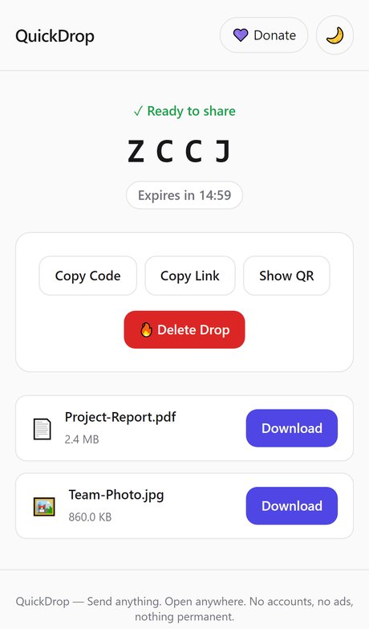<br /><sub>Code + QR</sub></td>
    <td align="center">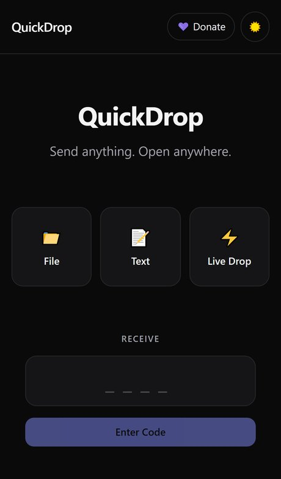<br /><sub>Dark mode</sub></td>
  </tr>
</table>

<p align="center">
  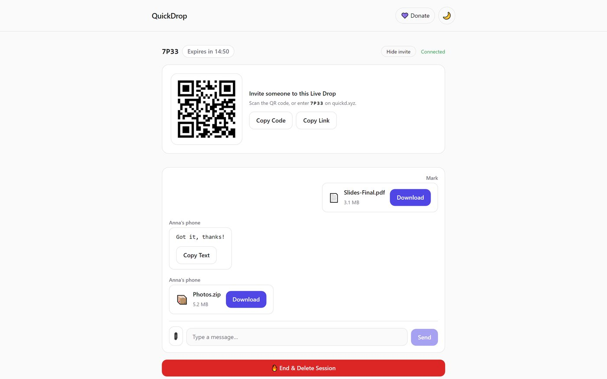<br />
  <sub>A Live Drop session on desktop, mirrored in real time on the guest's phone.</sub>
</p>

### Edge cases, handled

<table>
  <tr>
    <td align="center">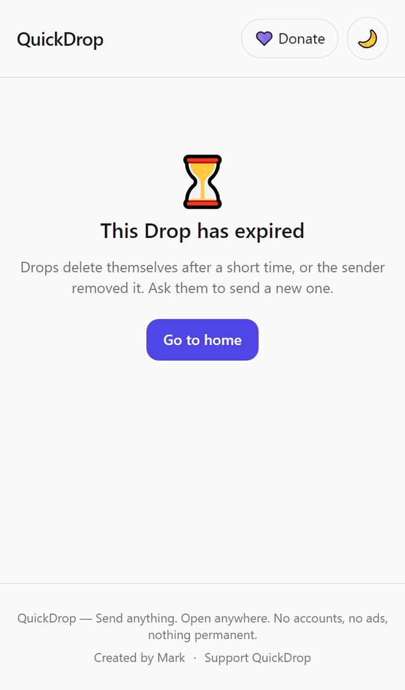<br /><sub>Expired Drop</sub></td>
    <td align="center">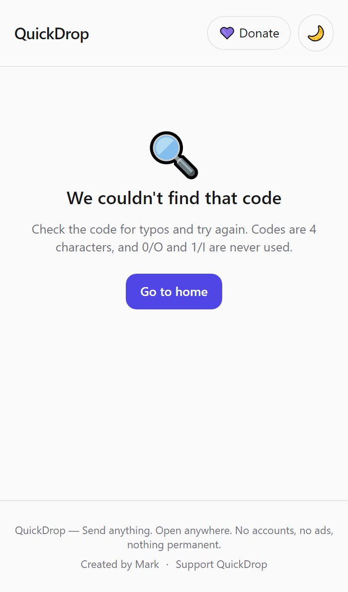<br /><sub>Unknown code</sub></td>
    <td align="center">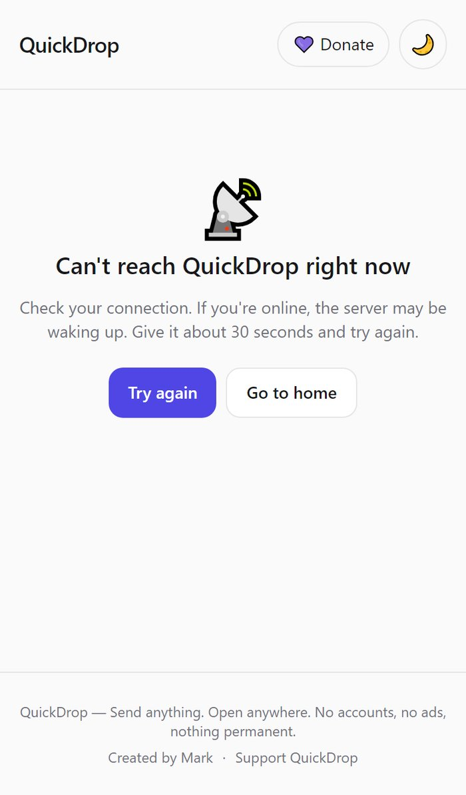<br /><sub>Offline</sub></td>
    <td align="center">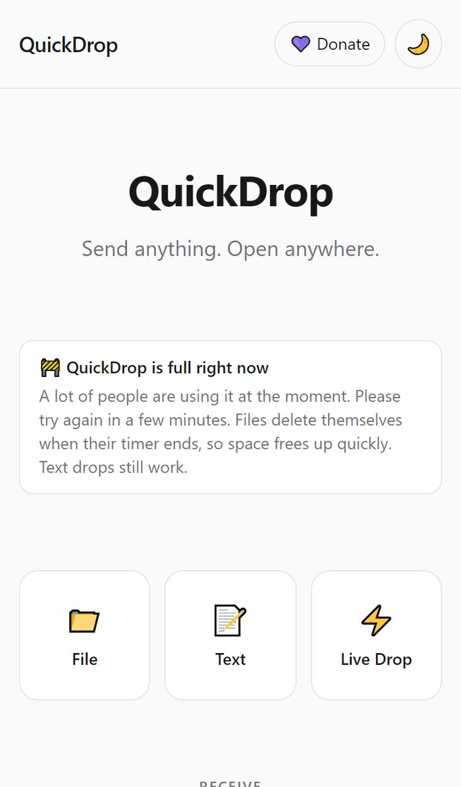<br /><sub>Server full</sub></td>
  </tr>
</table>

## How to use it

### Send a file or text

1. Open **quickd.xyz**, pick **File** or **Text**, add your content and choose
   how long it lives (5-30 minutes). Optionally set a password or burn-after-download.
2. QuickDrop gives you a **4-character code**, a link and a **QR code**.
3. On the other device, open quickd.xyz and type the code (or scan the QR).
4. Download or copy. When the timer ends, the Drop is deleted server-side.

<table>
  <tr>
    <td align="center"><br /><b>1.</b> Add files</td>
    <td align="center"><br /><b>2.</b> Share the code or QR</td>
  </tr>
</table>

### Start a Live Drop

1. Choose **Live Drop**, enter a nickname and a duration.
2. Share the invite code or QR. Guests ask to join and **you approve each one**.
3. Chat and trade files in real time. Only the host can end the session,
   which wipes everything.

<table>
  <tr>
    <td align="center">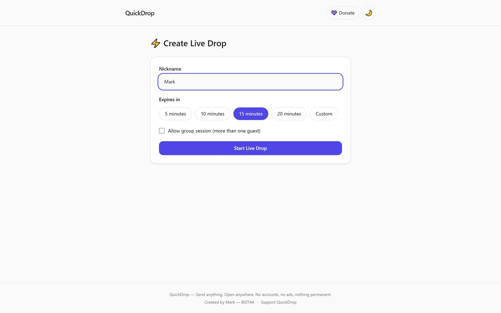<br /><b>1.</b> Host starts</td>
    <td align="center">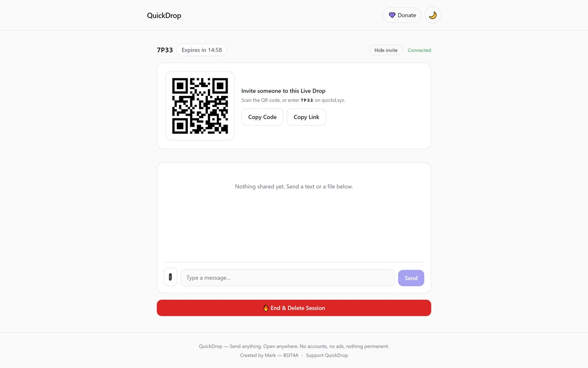<br /><b>2.</b> Invite via QR</td>
  </tr>
  <tr>
    <td align="center">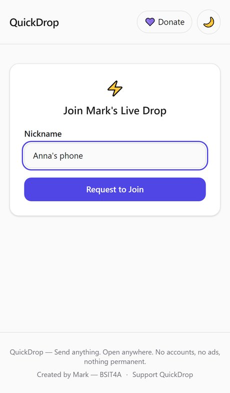<br /><b>3.</b> Guest joins</td>
    <td align="center">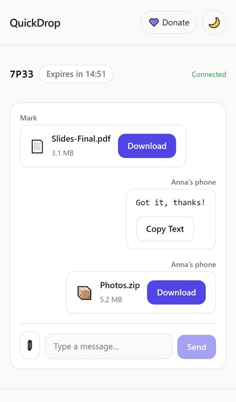<br /><b>4.</b> Chat and share</td>
  </tr>
</table>

## Architecture

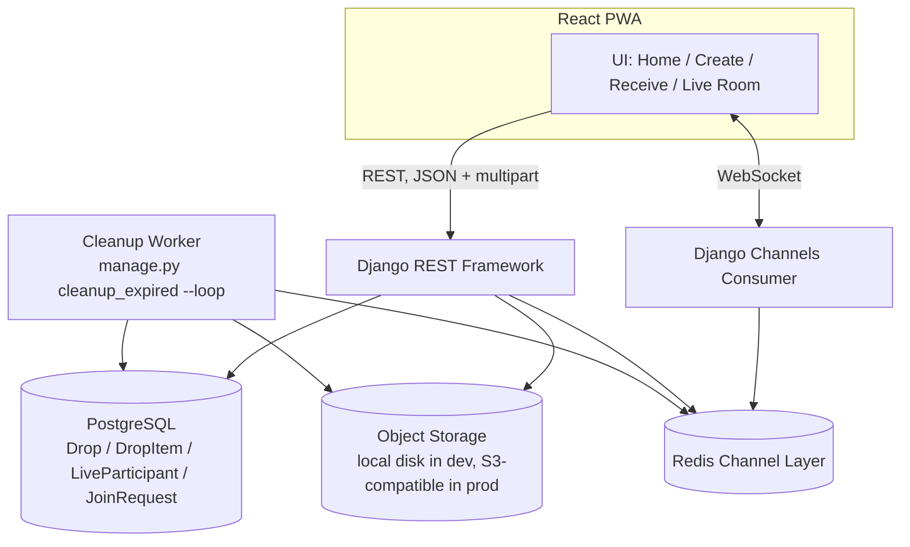

**Why this shape:**
- **Postgres holds metadata only, never file bytes.** Keeping the database
  small and fast is what lets code lookups and expiration sweeps stay cheap
  even as total Drop volume grows; file bytes live behind a swappable
  storage abstraction instead (see [Storage architecture](#storage-architecture)).
- **Redis is the Channels layer**, fanning WebSocket broadcasts (a Live Drop
  message, a join-request decision, a session end) out to every connected
  participant's socket process without those processes needing to share
  memory.
- **A separate worker process owns expiration**, rather than expiring Drops
  lazily on read. A Drop that nobody ever visits again still needs its files
  deleted; a background sweep is the only way to guarantee that (see the cleanup sweep).

## Tech stack

**Frontend:** React 19, TypeScript (strict), Vite, Tailwind CSS 4, React
Router. Component layout follows `components/ features/ pages/ hooks/
services/ types/ utils/` so feature logic (e.g. the Live Drop room) stays
isolated from generic UI primitives (`Button`, `Card`, `Input`, ...).

**Backend:** Python, Django, Django REST Framework, Django Channels (+
Daphne as the ASGI server), PostgreSQL, Redis. Business logic lives in a service layer, not in views — views translate HTTP
into service calls and serializers back to JSON, nothing more.

## Security model

| Concern | Mitigation |
|---|---|
| Drop codes brute-forced | 4+ char codes (configurable length) drawn from a 32-character alphabet with `secrets`, collision-checked against the DB; code lookup is rate-limited. The code is a **convenience identifier, not a secret** — anyone with it can *view* a Drop's contents, exactly like a physical key handed over verbally, but never *manage* it. |
| Drop management (delete, approve/reject guests, end a Live Drop) | A separate high-entropy **management token** (`secrets.token_urlsafe(32)`) is generated at creation and returned to the creator exactly once. Every management action requires it via `X-Management-Token`; the public code alone is deliberately insufficient. |
| Live Drop participant identity | Each participant (host or guest) gets their own SHA-256-hashed **participant token** (256 bits of randomness, so a slow hash adds cost without adding security; legacy PBKDF2 hashes still verify), proven over both the REST endpoints and the WebSocket handshake. A guest's token is only ever handed to *that guest's own browser*, once, via a claim endpoint keyed on their own unguessable join-request id. |
| Passwords on a Drop | Hashed with Django's password hasher (PBKDF2 by default); plaintext is never persisted. |
| Uploaded files | Filenames are sanitized and stripped of any path component before being kept as *metadata only*; the actual storage key is a random UUID, so the original filename can never influence where a file lands. Files are never placed under a public/static/media URL — downloads are always proxied through an authenticated, expiration-checked view. Dangerous extensions (`.exe`, `.bat`, `.apk`, `.msi`, `.ps1`, ...) are flagged and the receiver sees an explicit warning before downloading. Files are never executed by the server. |
| Abuse / scraping | Per-client rate limits on Drop creation, code lookup, downloads, join requests, Live Drop messages/decisions, and deletion, tunable via env vars. Clients are identified by Cloudflare's `CF-Connecting-IP` (with a right-anchored `X-Forwarded-For` fallback) - **not** DRF's default, which trusts the whole client-controllable `X-Forwarded-For` header and was found to be both spoofable and ineffective behind Render's proxy. |
| Storage exhaustion | Total size cap per Drop, a global storage budget that refuses new uploads when nearly full, early rejection of oversized requests by `Content-Length`, message/item/pending-request caps, and cleanup of already-written files if an upload fails partway. Set an R2 lifecycle rule (delete objects after 1 day) as a backstop in case the sweep ever misses one. |
| Hostile uploads | Every download is served as `application/octet-stream` with `nosniff` + `attachment`, regardless of the type the uploader claimed. |
| Frontend | Strict Content-Security-Policy (scripts `'self'` only), `frame-ancestors 'none'`, `nosniff`, referrer and permissions policies. |
| Admin surface | Django's `/admin/` is mounted only when `DEBUG` is on; QuickDrop has no accounts to administer. |
| Standard web vectors | CORS allowlist, CSRF-trusted origins, `X-Content-Type-Options: nosniff`, `X-Frame-Options: DENY`, HSTS in production, parameterized ORM queries (no raw SQL), no user-controlled template rendering. |
| Error responses | A single exception handler (`quickdrop.exceptions`) guarantees the client only ever sees a generic message — raw stack traces and internal exception text never leave the server. |

## Privacy model

- No accounts, no persistent identity. Nicknames in Live Drop exist only for
  the session's lifetime and are discarded with it.
- First-party, anonymous analytics only (`/admin`): counts by page kind, referrer domain, country, device and browser. No cookies, no third-party trackers, no fingerprinting; visitors are counted once a day via a salted hash that is never stored with an IP, and the beacon honors Do Not Track / Global Privacy Control. Drop codes, contents, nicknames and filenames are never recorded.
- IP addresses are used transiently for rate limiting only (in-memory/Redis
  throttle state with its own TTL) and are not persisted alongside Drop
  content.
- Recent Drops history lives entirely in the browser's `localStorage` — the
  server has no notion of "your" Drops beyond the management token you hold.

## Storage architecture

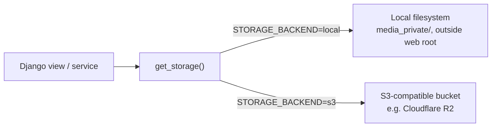

Both backends implement the same tiny interface (`save`, `open`, `delete`).
Switching from local disk in development to Cloudflare R2 (or any other
S3-compatible provider) in production is a matter of environment variables
(`STORAGE_BACKEND=s3`, `AWS_*`) — no application code changes. This also
means QuickDrop is never locked into one hosting vendor.

## WebSocket / Live Drop architecture

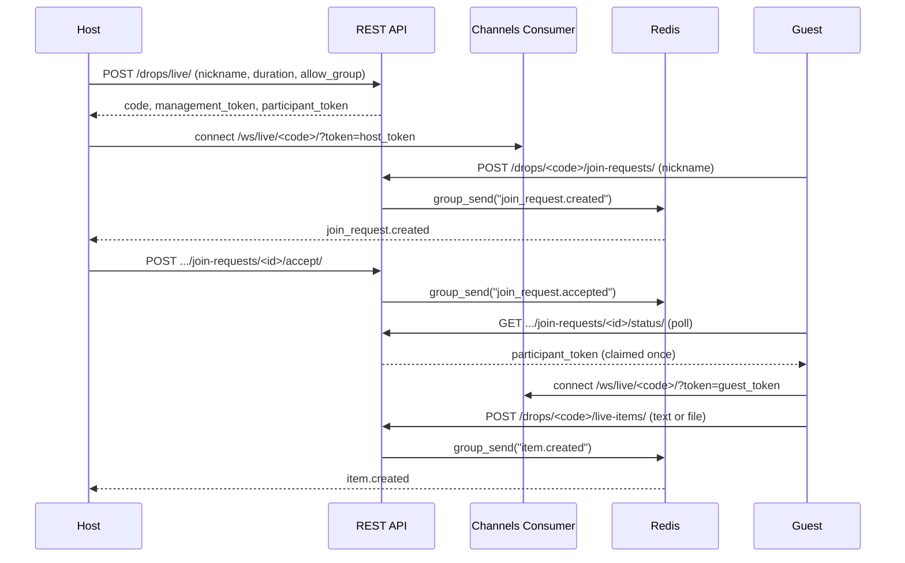

Everything participants exchange goes through the authenticated REST layer
first (so it's validated, persisted, and storage-backed identically to a
plain File/Text Drop) and is *then* fanned out over the Channels/Redis group
for that room — the WebSocket is a broadcast channel, not a second source of
truth. On reconnect (a network hiccup, a refresh), the client re-fetches the
room's full current state so nothing sent while it was briefly disconnected
is lost.

## API overview

All endpoints are under `/api/`. Selected routes:

| Method | Path | Purpose |
|---|---|---|
| GET | `/config/` | Public config (code length, size limits, expiration options) |
| POST | `/drops/` | Create a File/Text Drop (multipart) |
| POST | `/drops/live/` | Create a Live Drop |
| GET | `/drops/<code>/peek/` | Safe pre-auth check (type, has_password, time left) |
| POST | `/drops/<code>/access/` | Full contents (verifies password if set) |
| DELETE | `/drops/<code>/` | Delete/end a Drop (`X-Management-Token` required) |
| GET | `/drops/<code>/items/<id>/download/` | Stream a file (records download, enforces burn) |
| POST | `/drops/<code>/join-requests/` | Guest requests to join a Live Drop |
| POST | `/drops/<code>/join-requests/<id>/accept\|reject/` | Host decision (`X-Participant-Token`) |
| POST | `/drops/<code>/live-items/` | Post a message/file into a Live Drop (`X-Participant-Token`) |
| WS | `/ws/live/<code>/?token=...` | Real-time room event stream |

## Status

QuickDrop is live at [quickd.xyz](https://www.quickd.xyz) and runs on free-tier infrastructure. It is a soft launch, so expect rough edges and the occasional cold start.

<p align="center">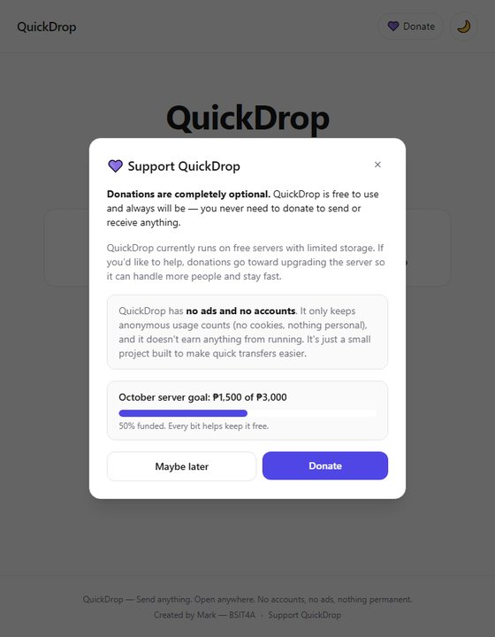<br /><sub>An optional, transparent monthly donation goal.</sub></p>

## Limitations

- Uploads are single-shot (no chunking/resuming); a 250 MB upload that drops
  mid-transfer must be restarted.
- Live Drop's "push-only" design means all room content goes through REST
  first and Redis pub/sub second — there is no end-to-end encryption today
  (the server can, in principle, read Drop contents; see roadmap).
- The Web Share Target integration only handles shared text/links (a GET
  target); shared *files* from the OS share sheet require a service-worker
  `POST` interception that isn't implemented in V1.
- PWA icons are placeholder SVGs; production needs real PNG icon assets
  (including maskable variants) for full cross-platform install support.
- No malware scanning on uploaded files — dangerous extensions are flagged
  in the UI, but content isn't inspected.

## Future roadmap

- Malware scanning on upload (the storage pipeline is already structured to
  add a scan step before a file is marked available).
- End-to-end encryption for Drop contents.
- Chunked/resumable uploads for larger files.
- WebRTC peer-to-peer transfer for Live Drop (skip the server for the file
  bytes entirely).
- Optional device pairing / trusted-device shortcuts.
- Full share-sheet integration for files, not just text/links.
- Native desktop/mobile companion clients.
- Transfer statistics (aggregate, non-identifying).
- Custom, per-Drop expiration policies beyond the fixed option set.
